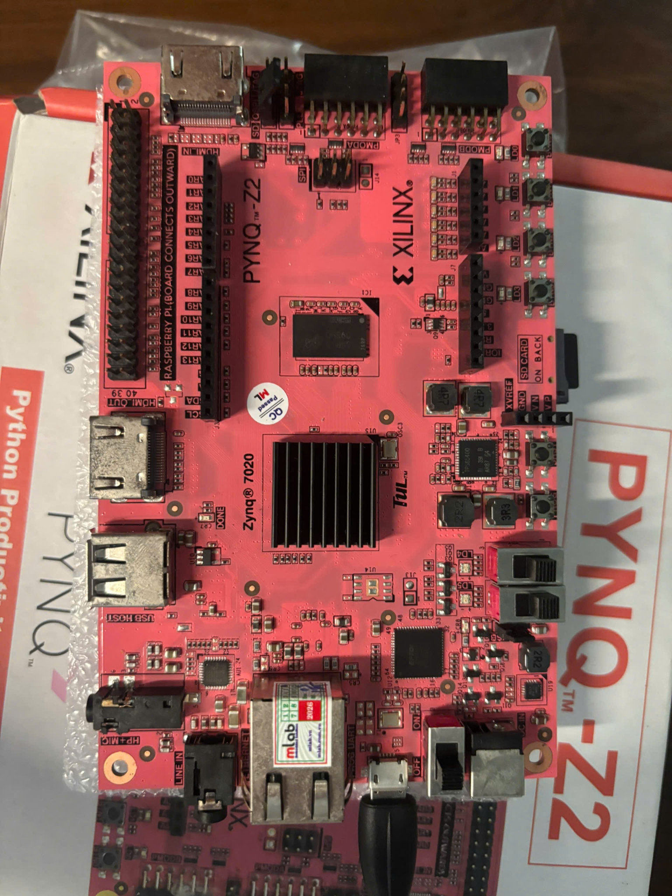
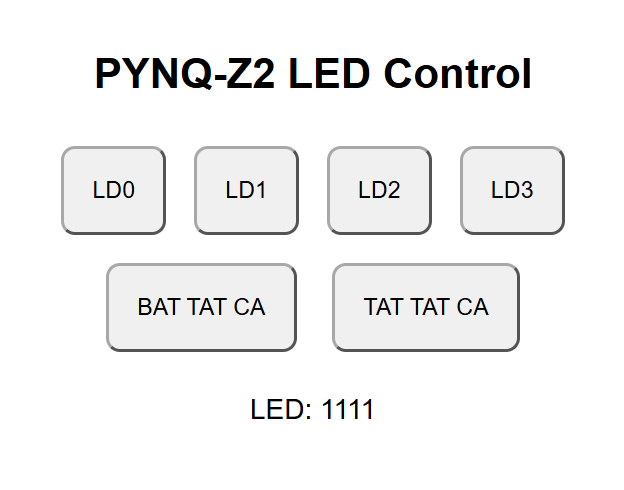
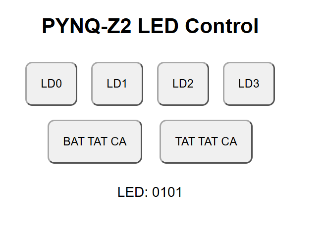
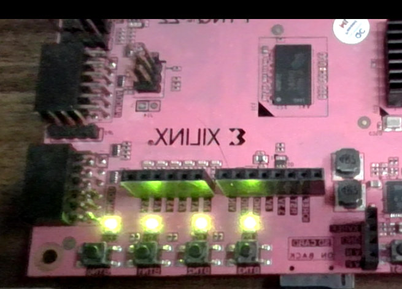
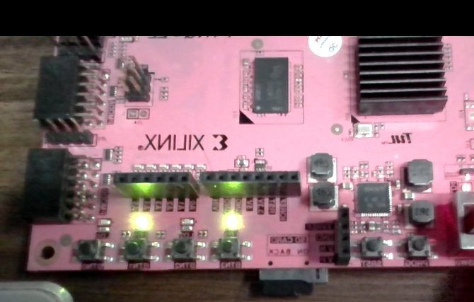

# LED Control FPGA by Phone — PYNQ-Z2

Bài thực hành điều khiển **4 LED LD0–LD3** trên FPGA PYNQ-Z2 thông qua **AXI4-Lite**, **Python trên Jupyter** và một trang web đơn giản chạy trực tiếp trên board. Source được giữ gọn trong **một Notebook có đúng 3 code cell**; không cần thư mục `Website/` hoặc file `.hwh`.

## Hình ảnh minh chứng thực tế

Đây là **ảnh board và ảnh giao diện do người thực hiện cung cấp**, không phải ảnh tạo bằng AI hay bản mô phỏng.

**Board PYNQ-Z2 sử dụng trong thí nghiệm:**



**Website đang hiển thị trạng thái `1111` và `0101`:**

| Giao diện: `LED: 1111` | Giao diện: `LED: 0101` |
|---|---|
|  |  |

**Ảnh quan sát LED trên board:**

| Bốn LED cùng sáng | Hai LED sáng ở một lần kiểm tra |
|---|---|
|  |  |

Ảnh bổ sung: [giao diện trên trình duyệt PC, LED: 1101](Docs/Images/Website/website_browser_1101.png), [ảnh trạng thái board 03](Docs/Images/Hardware/led_state_capture_03.jpg), [ảnh trạng thái board 04](Docs/Images/Hardware/led_state_capture_04.jpg).

> **Giới hạn minh chứng:** Ảnh giao diện và ảnh board không nhất thiết được chụp đồng thời; chúng cho thấy giao diện web đã mở được trên PC và có các trạng thái LED khác nhau. Chưa có ảnh chứng minh thao tác **trực tiếp từ điện thoại**. Khi thực hiện bước đó, nên bổ sung ảnh điện thoại điều khiển và board thay đổi trạng thái vào `Docs/Images/`.

## Cấu trúc repository

```text
LED_Control_FPGA_by_Phone/
├── Vivado/                       # Bổ sung mã HDL, Block Design, .xdc, IP từ máy cá nhân
├── Bitstream/
│   └── design_1_wrapper.bit      # Bổ sung file .bit THẬT đã tạo bằng Vivado
├── Jupyter/
│   └── LED_Control.ipynb         # Duy nhất 3 code cell: nạp .bit, MMIO, website
├── Docs/
│   └── Images/
│       ├── Hardware/            # 5 ảnh board thực tế
│       ├── Website/             # 3 ảnh web thực tế
│       ├── Vivado/              # Dành cho ảnh thiết kế Vivado
│       └── Jupyter/             # Dành cho ảnh chạy Notebook
├── README.md
└── .gitignore
```

**Quan trọng:** ZIP chỉ chứa notebook và ảnh minh chứng được cung cấp; **không chứa file `.bit` hoặc toàn bộ source Vivado thực tế**. Bạn cần sao chép những file đó từ máy cá nhân. Không đưa Bitstream giả vào repo.

## Phần cứng và ánh xạ thanh ghi

| Thành phần | Giá trị |
|---|---|
| Board | PYNQ-Z2, SoC Zynq-7020 (`xc7z020clg400-1`) |
| Công cụ | Vivado 2026.1 |
| Custom IP | `MY_IP_0` (AXI4-Lite Slave) |
| Base Address | `0x43C00000` |
| Range trong Vivado | 64 KB |
| Thanh ghi điều khiển LED | `slv_reg0`, offset `0x00` |
| Kết nối Verilog | `assign LED_out = slv_reg0[3:0];` |
| LED LD0 / LD1 / LD2 / LD3 | FPGA pin `R14` / `P14` / `N16` / `M14` |
| Chuẩn I/O | `LVCMOS33` |

Ghi `0b1111` để bật 4 LED; ghi `0b0000` để tắt cả 4. Các bit 0–3 tương ứng LD0–LD3. File XDC phải ánh xạ đúng các cổng `LED_out_0[0]` đến `LED_out_0[3]`.

## Kết nối thiết bị

```text
Trình duyệt trên PC (hoặc thiết bị khác nếu mạng đã được chuyển tiếp)
                 │ HTTP
                 ▼
       Python Flask trên ARM PYNQ-Z2
                 │ MMIO: 0x43C00000 + 0x00
                 ▼
       Custom AXI4-Lite IP trong FPGA (PL)
                 │ slv_reg0[3:0]
                 ▼
             LD0–LD3
```

Trong bài thực hành: **PC Ethernet `192.168.2.1`**, **PYNQ-Z2 Ethernet `192.168.2.99`**. Jupyter đã được mở trên PC qua `http://192.168.2.99:9090` và web điều khiển qua `http://192.168.2.99:5000`.

**Điện thoại:** Vì PC nối board bằng Ethernet trực tiếp và điện thoại dùng Wi-Fi, muốn điện thoại điều khiển được cần bổ sung định tuyến/chuyển tiếp HTTP qua PC hoặc chuyển board cùng mạng router. Ảnh hiện tại mới chứng minh việc truy cập web từ PC.

## Hướng dẫn chạy Notebook (3 code cells)

1. Sao chép file `.bit` thật vào **cùng thư mục với** `LED_Control.ipynb` trên board, hoặc sử dụng cấu trúc `Bitstream/` và `Jupyter/` cùng cấp như cây repo.
2. Mở Jupyter tại `http://192.168.2.99:9090`, chọn `LED_Control.ipynb`.
3. Chạy **Cell 1** — nạp `design_1_wrapper.bit` bằng `pynq.Bitstream`, **không cần `.hwh`**.
4. Chạy **Cell 2** — `pynq.MMIO` ghi một giá trị 4 bit vào `slv_reg0`; thay `LED_VALUE` để kiểm tra từng LED hoặc cả 4 LED.
5. Chạy **Cell 3** — bật Flask web server ngay trong Notebook. Trên PC, mở `http://192.168.2.99:5000`; dùng các nút `LD0`–`LD3`, `BAT TAT CA`, `TAT TAT CA`.

Nếu báo `ModuleNotFoundError: No module named 'flask'`, cần cài Flask vào môi trường kernel Jupyter của PYNQ-Z2 rồi chạy lại Cell 3. Trước khi chạy web, nên giữ một kernel duy nhất để tránh hai server cùng chiếm cổng 5000.

**Lưu ý kỹ thuật:** Thiết kế HDL `assign LED_out = slv_reg0[3:0]` chỉ tạo chức năng bật/tắt theo giá trị thanh ghi. Notebook hiện tại **không có nút nhấp nháy tự động**; việc thêm điều khiển nhấp nháy hoặc bộ đếm xung FPGA là hướng mở rộng, không được trình bày là đã hoàn thành.

## Trạng thái dự án và báo cáo Lab

- Có minh chứng thực tế về website đang chạy trên PC và các LED trên board.
- Đã có ảnh từng bước thiết kế AXI IP, Block Design, Address Editor, pin Constraints, Jupyter trong lịch sử thực hành; có thể bổ sung vào `Docs/Images/Vivado` và `Docs/Images/Jupyter`.
- Báo cáo `Docs/Lab_01.pdf` **chưa được soạn trong gói này**; sẽ biên soạn sau, sử dụng ảnh thực tế và phân biệt rõ phần đã kiểm chứng/chưa kiểm chứng.

## GitHub

Không commit các thư mục Vivado tạo tự động (`.cache`, `.runs`, `.sim`, `.gen`...), notebook checkpoint, và cache Python. Khi đưa Custom IP vào `Vivado/`, kiểm tra lại **IP Repository Path** vì project trước đó có IP nguồn ở `D:\ip_repo`.

Chỉ mở web server điều khiển LED trên LAN đáng tin cậy; ứng dụng thử nghiệm chưa có xác thực, không công khai cổng 5000 ra Internet.
